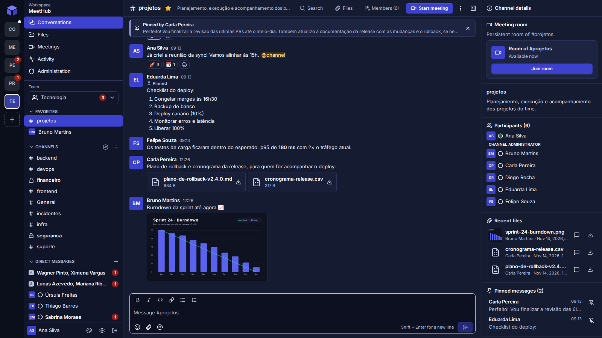
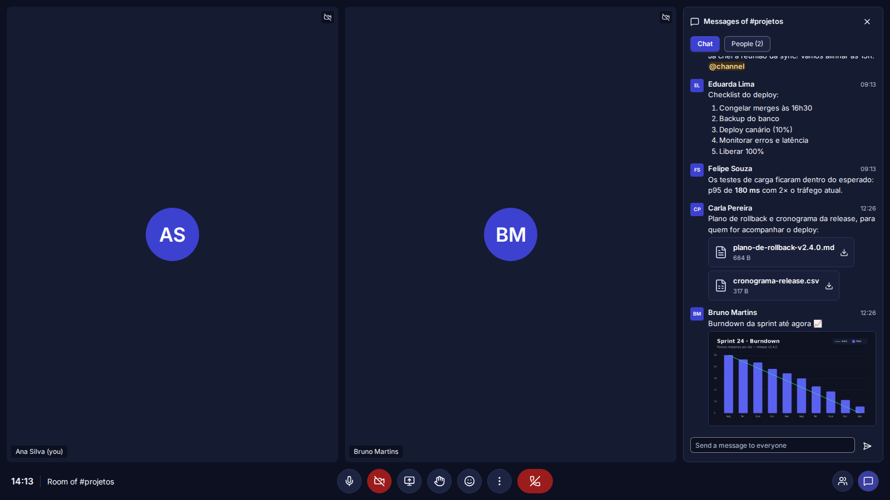
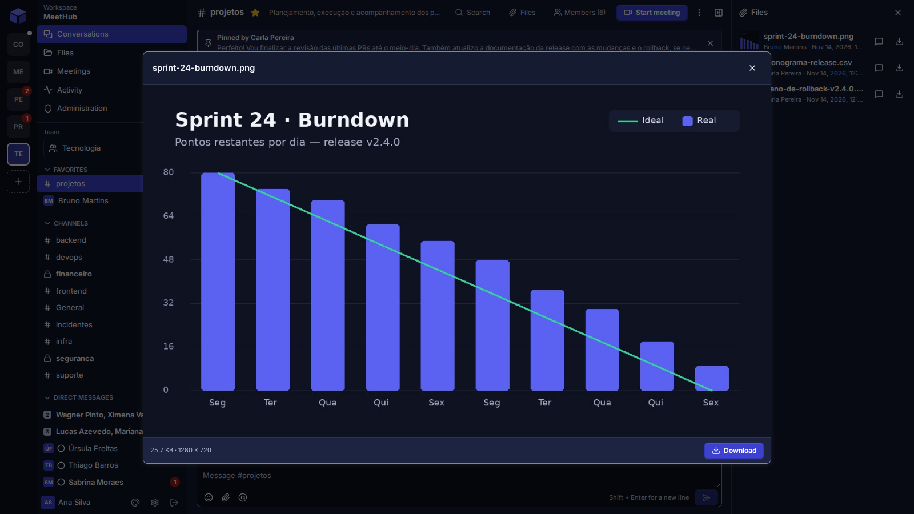
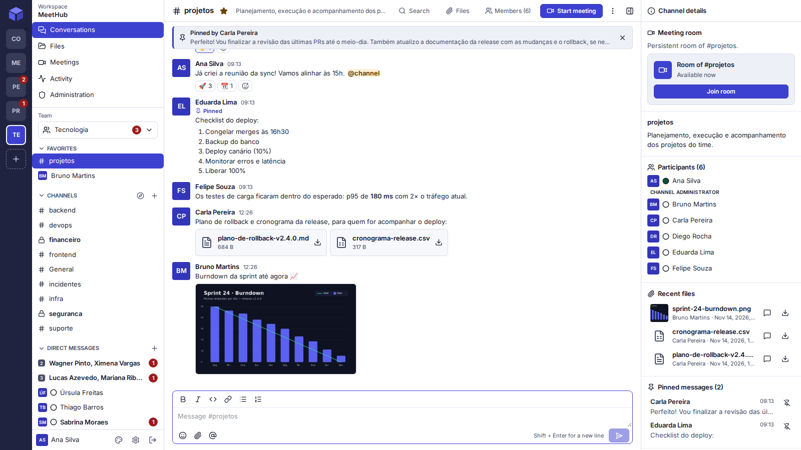
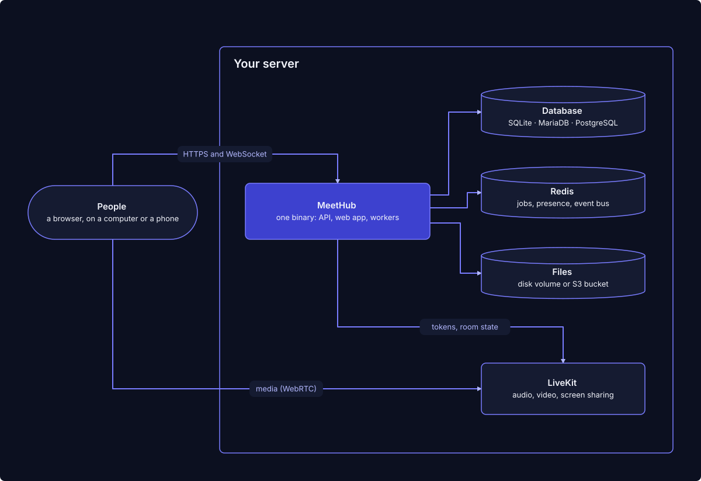

<p align="center">
  <picture>
    <source media="(prefers-color-scheme: dark)" srcset="frontend/src/assets/brand/logo-dark.svg">
    
  </picture>
</p>

<h3 align="center">Team chat, files and video meetings — on your own server.</h3>

<p align="center">
  One small binary, your database, your domain. Running in a minute, yours to keep.
</p>

<p align="center">
  <a href="https://github.com/jniltinho/meethub/releases/latest"></a>
  <a href="https://github.com/jniltinho/meethub/releases"></a>
  <a href="https://github.com/jniltinho/meethub/actions/workflows/ci.yml"></a>
  <a href="https://github.com/jniltinho/meethub/actions/workflows/docker-image-publish.yml"></a>
  <a href="LICENSE"></a>
</p>

<p align="center">
  <a href="https://github.com/jniltinho/meethub/releases/latest"><b>⬇ Download the latest release</b></a>
</p>

<p align="center">
  <a href="#try-it-in-a-minute">Try it</a> ·
  <a href="#what-you-get">Features</a> ·
  <a href="#run-it-your-way">Deployment</a> ·
  <a href="docs/architecture.md">Architecture</a> ·
  <a href="docs/security.md">Security</a>
</p>



## Why teams choose MeetHub

- **Your conversations stay yours.** MeetHub runs on your server, with your database and your backups. Messages,
  files and calls never have to leave your infrastructure.
- **Chat, files and meetings in one place.** Every channel has its conversation, its files and its own meeting room.
  One login, one search, one place to look.
- **No per-seat bill.** MeetHub is open source under the MIT license: add the whole company, guests included.
- **Up in a minute, easy to keep.** One container is a complete install. Upgrades are "pull and restart"; the
  database migrates itself.
- **Feels familiar on day one.** Teams, channels, direct messages and threads work the way people already know from
  Mattermost, Slack and Teams.
- **Made for everyone on the team.** Keyboard and screen-reader friendly, 22 themes (six of them at WCAG AAA
  contrast), English, Portuguese and Spanish, phone to 4K.

## See it

| | |
| --- | --- |
| **Meetings in every channel** — join from the channel, keep its chat beside the call.<br><br> | **Files where the conversation is** — drop, paste or attach; images preview, everything is one click away.<br><br> |
| **Light, dark and 20 more themes** — each person picks their own.<br><br> | **On the phone too** — the same app in the browser, nothing to install.<br><br> |

## What you get

**Conversations**

- Teams, public and private channels, direct and group messages, with a team rail to switch between teams.
- Threads, reactions, `@mentions` (`@channel`, `@here`), Markdown, 1 800+ emoji, pinned messages and favorites.
- Message search with `from:` and `in:`, and a jump straight to the message in its channel.
- Activity: mentions and replies to your threads in one place, with desktop notifications and an e-mail for what
  you missed.
- Real-time delivery, unread and mention counts, typing indicators and presence (online, away, do not disturb).
- It keeps working on a bad connection: a message that could not be sent stays with a Retry, and the app catches up
  by itself when the connection returns.

**Files**

- Attach by button, drag and drop or paste; up to 10 files per message, 50 MiB each by default.
- Thumbnails and previews for images, a files panel in every channel and a Files page across all your conversations.
- Stored on a disk volume or in any S3-compatible bucket ([RustFS](https://github.com/rustfs/rustfs), MinIO, AWS S3).

**Meetings** (through [LiveKit](https://livekit.io), self-hosted)

- One persistent room per channel and conversation: no links to create or share.
- Camera and microphone check before joining, screen sharing, raise hand, reactions, the people list and the
  channel's chat beside the call.
- Everyone sees who is in a room, from the channel header, the sidebar and the Meetings page.

**Administration and security**

- Roles (owner, admin, member, guest), user management, an audit log of administrative actions.
- Server-side sessions, CSRF protection, rate limits, strict security headers and a locked-down content policy.
- Files are only served to people who can read their channel, and never render from MeetHub's origin.
- Secrets only through the environment — never in a configuration file, a log or the audit trail.

More in the [security notes](docs/security.md).

## Try it in a minute

You need Docker. This starts a complete MeetHub (the server and Redis, SQLite on one volume):

```bash
docker run -d --name meethub -p 8080:8080 -v meethub-data:/data --stop-timeout 45 \
  ghcr.io/jniltinho/meethub:main-allinone
docker logs meethub     # shows the setup address and the one-time setup token
```

Open <http://localhost:8080>, enter the token, name your organization and create the first account.

Prefer to look around with sample data first? From a checkout, this brings up the full stack (with LiveKit for
meetings) and fills it with a demo company — 30 people, 4 teams, channels with history, threads and files:

```bash
git clone https://github.com/jniltinho/meethub && cd meethub
make up      # MeetHub + Redis + LiveKit on http://localhost:8080
make demo    # sample users, teams, channels and conversations (prints how to log in)
```

## Run it your way

| | For | What runs |
| --- | --- | --- |
| **All-in-one image** | A single host, a small team, a first look | One container: MeetHub and Redis, SQLite on a volume |
| **Linux package** | A server without Docker | A `.deb` or `.rpm`: everything in `/opt/meethub`, a systemd service, the distribution's Redis |
| **Compose stack** | A team server with meetings | MeetHub, Redis and LiveKit; SQLite, MariaDB or PostgreSQL |
| **Replicas** | Larger installs, no single point of failure | Several MeetHub replicas behind a load balancer, PostgreSQL or MariaDB, Redis, an S3 bucket, LiveKit |

MeetHub is one static binary (linux/amd64) with the web app embedded; every setting is an environment variable or a
line in `config.toml`. The [deployment guide](docs/deployment.md) covers configuration, reverse proxies, file storage,
LiveKit, backups and the production checklist.

Without Docker, on Ubuntu 26.04 or Debian 13 — a package from the
[releases](https://github.com/jniltinho/meethub/releases) ([step by step](docs/install-linux.md)):

```bash
curl -fLO https://github.com/jniltinho/meethub/releases/latest/download/meethub_amd64.deb
sudo apt install ./meethub_amd64.deb
```



How the pieces work together — message delivery, uploads, joining a meeting, scaling out — is in the
[architecture guide](docs/architecture.md).

## Where it stands

MeetHub is young and moving fast. What is in this README works today and is covered by automated tests on SQLite,
MariaDB and PostgreSQL: unit and integration tests, browser tests of every screen, accessibility and contrast checks,
and a load test (1 000 connections, a 500-member channel, slow clients, a Redis restart).

Not there yet, so you can plan around it:

- Single sign-on (OIDC, SAML, LDAP) and two-factor authentication — login is e-mail and password.
- Push notifications on phones — notifications are on the desktop and by e-mail.
- Native mobile and desktop apps — MeetHub is a responsive web app.
- Meeting recordings.

Meetings need a LiveKit server reachable by your users; the Compose stack sets one up for a single host, and the
[deployment guide](docs/deployment.md#meetings-livekit) explains what a public install needs (TLS, ports, TURN).

Found a problem or missing something for your team? [Open an issue](https://github.com/jniltinho/meethub/issues).

## Documentation

- [Deployment](docs/deployment.md) — all-in-one image, Compose stack, configuration, file storage, meetings, proxies,
  production checklist
- [Install on Ubuntu and Debian](docs/install-linux.md) — the `.deb` (and `.rpm`): `/opt/meethub`, the systemd
  service, first start, upgrades, backups
- [Install the binary](docs/install-binary.md) — the same by hand, from the `.tar.gz`, on any distribution
- [Architecture](docs/architecture.md) — the pieces and how a message, a file and a meeting flow through them
- [Security](docs/security.md) — secrets, sessions, CSRF, uploads, rate limits, headers
- [API](docs/api.md) — `/api/v1` endpoints, real-time events, errors, roles and permissions
- [Themes](docs/themes.md) — the theme contract and how to add your own
- [Brand](docs/brand.md) — the logo and its colors
- [Changelog](CHANGELOG.md) — what each release brings

## For developers

Go (Cobra, Echo v5, GORM, Asynq) with an embedded Vue 3 + TypeScript app. Everything builds and tests in Docker; the
host needs only Docker and `make`.

```bash
make build      # dist/meethub: the static linux/amd64 binary
make package    # dist/packages: the .deb, .rpm and .tar.gz of that binary
make check      # gofmt, go vet, golangci-lint, govulncheck, frontend lint and types
make test       # Go tests with -race and the frontend unit tests
make test-db    # the Go tests on SQLite, MariaDB and PostgreSQL (and an S3 service)
make test-e2e   # browser tests on the three databases
make dev        # Vite dev server with hot reload in front of the stack
```

Behavior changes go through [OpenSpec](openspec/) (proposal, specs with testable scenarios, tasks); the conventions
are in [AGENTS.md](AGENTS.md). The chat follows the Mattermost model and API shapes where it makes sense.

## License

[MIT](LICENSE)
