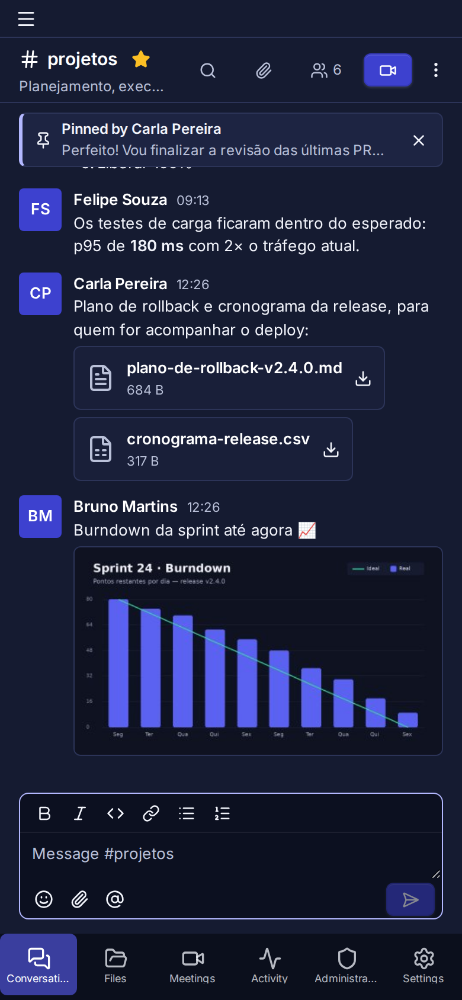

<p align="center">
  <picture>
    <source media="(prefers-color-scheme: dark)" srcset="frontend/src/assets/brand/logo-dark.svg">
    
  </picture>
</p>

<p align="center">
  <b>Team chat, files and video meetings — on your own server.</b><br>
  Channels, threads, attachments and a meeting room in every channel.<br>
  One small binary, your database, your domain. Running in a minute, yours to keep.
</p>

<p align="center">
  <a href="https://github.com/jniltinho/meethub/releases/latest"></a>
  <a href="https://github.com/jniltinho/meethub/actions/workflows/ci.yml"></a>
  <a href="https://github.com/jniltinho/meethub/releases"></a>
  <a href="https://go.dev/"></a>
  <a href="LICENSE"></a>
  <a href="https://github.com/jniltinho/meethub/stargazers"></a>
</p>

<p align="center">
  <a href="#-try-it-in-one-minute">Try it</a> ·
  <a href="#-screenshots">Screenshots</a> ·
  <a href="#-what-you-get">Features</a> ·
  <a href="docs/README.md">Documentation</a> ·
  <a href="https://github.com/jniltinho/meethub/releases/latest">Download</a>
</p>

<p align="center">
  
</p>

## ✨ Why teams pick it

- 🏠 **Your conversations stay yours** — MeetHub runs on your server, with your database and your backups. Messages, files and calls never have to leave your infrastructure.
- 💬 **Chat, files and meetings in one place** — every channel has its conversation, its files and its own meeting room. One login, one search, one place to look.
- 💸 **No per-seat bill** — open source under the MIT license: add the whole company, guests included.
- ⚡ **Up in a minute, easy to keep** — one container or one package is a complete install. Upgrades are "install and restart"; the database migrates itself.
- 👋 **Familiar on day one** — teams, channels, direct messages and threads work the way people already know from Mattermost, Slack and Teams.
- ♿ **Made for everyone on the team** — keyboard and screen-reader friendly, 22 themes (six of them at WCAG AAA contrast), English, Portuguese and Spanish, phone to 4K.

## 🚀 Try it in one minute

**With Docker** — one container with the server, Redis and LiveKit for meetings, SQLite on one volume:

```bash
docker run -d --name meethub -p 8080:8080 -p 7880:7880 -p 7881:7881 -p 7882:7882/udp \
  -v meethub-data:/data --stop-timeout 55 ghcr.io/jniltinho/meethub:main-allinone
```

```bash
docker logs meethub     # the setup address and the one-time setup token
```

**On a server** (Ubuntu 26.04 or Debian 13, x86_64) — a package that puts everything in `/opt/meethub` and runs
it as a systemd service:

```bash
curl -fLO https://github.com/jniltinho/meethub/releases/latest/download/meethub_amd64.deb
```

```bash
sudo apt install ./meethub_amd64.deb
```

```bash
sudo cat /opt/meethub/data/setup-token     # the one-time setup token
```

Then open `http://localhost:8080`, enter the token, name your organization and create the first account. To open
it from another machine, set the address people use first (`public_url`): the
[install guide](docs/install-linux.md#first-start) shows how.

An `.rpm` and a `.tar.gz` of the binary are in the [releases](https://github.com/jniltinho/meethub/releases/latest)
too. Compose, MariaDB or PostgreSQL, several replicas and everything else: **[documentation](docs/README.md)**.

## 📸 Screenshots

| Meetings in every channel | Files where the conversation is |
|---------------------------|---------------------------------|
|  |  |

| Light, dark and 20 more themes | On the phone too |
|--------------------------------|------------------|
|  |  |

All screens use fictional data.

## 🧩 What you get

| | |
|---|---|
| **Conversations** | Teams, public and private channels, direct and group messages · threads, reactions, `@mentions`, Markdown, emoji · pinned messages and favorites · real-time delivery, unread counts, typing and presence |
| **Search and Activity** | Messages by word or phrase with `from:` and `in:`, and a jump to the message · mentions and replies to your threads in one place · desktop notifications, and an e-mail for what you missed |
| **Files** | Attach by button, drag and drop or paste · image thumbnails and previews · a files panel per channel and a Files page · on disk or in any S3-compatible bucket |
| **Meetings** | One persistent room per channel and conversation, through LiveKit · camera and microphone check · screen sharing at the screen's own resolution · raise hand, reactions, elapsed time, the channel's chat beside the call |
| **Administration** | Roles (owner, admin, member, guest) · user management · an audit log of administrative actions · a command line for users, migrations and checks |
| **Security** | Server-side sessions, CSRF protection, rate limits, strict headers · files served only to people who can read their channel · secrets only through the environment |
| **Interface** | 22 themes, light and dark · English, Portuguese (Brazil) and Spanish · keyboard and screen-reader support · phone to 4K |
| **Install** | A container image, a `.deb`, an `.rpm` or the bare binary · SQLite, MariaDB or PostgreSQL · one host, or several replicas behind a load balancer |

## 🧭 Good to know

MeetHub is young and moving fast, and says what it does not do yet: login is e-mail and password (no single
sign-on or two-factor authentication), there are no native mobile or desktop apps, no push notifications on
phones and no meeting recordings. What it does is covered by automated tests on SQLite, MariaDB and PostgreSQL.
The details: [Where it stands](docs/README.md#where-it-stands).

## 📚 Documentation

| | |
|---|---|
| [Documentation guide](docs/README.md) | Where to start, every feature, the ways to run it, where it stands, development |
| [Install on Ubuntu and Debian](docs/install-linux.md) | The `.deb` and `.rpm`: `/opt/meethub`, the systemd service, first start, upgrades, backups |
| [Install the binary](docs/install-binary.md) | The same by hand, from the `.tar.gz`, on any distribution |
| [Deployment](docs/deployment.md) | The all-in-one image, the Compose stack, configuration, file storage, meetings, proxies, the production checklist |
| [Architecture](docs/architecture.md) | The pieces and how a message, a file and a meeting flow through them |
| [Security](docs/security.md) | Secrets, sessions, CSRF, uploads, rate limits, headers |
| [API](docs/api.md) | `/api/v1` endpoints, real-time events, errors, roles and permissions |
| [Changelog](CHANGELOG.md) | What each release brings |

**Built with** Go · Echo · GORM · Asynq · Vue 3 · TypeScript · Tailwind CSS · LiveKit

```bash
make check && make test && make build    # only Docker and make on the host
```

## ⭐ Support the project

If MeetHub is useful to you, **star the repository**: it helps other people find it. Found a problem or missing
something for your team? [Open an issue](https://github.com/jniltinho/meethub/issues); to contribute, start with
the [development notes](docs/README.md#for-developers).

## License

[MIT](LICENSE)
