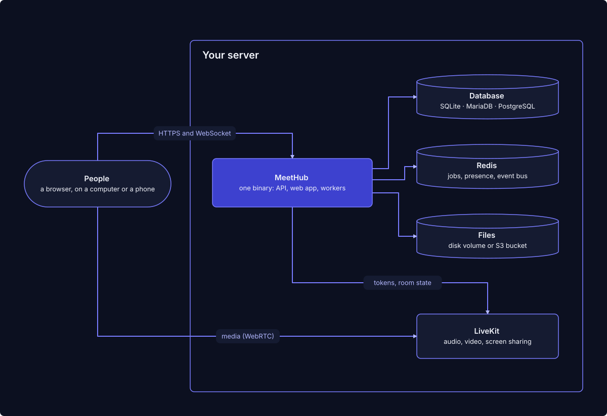
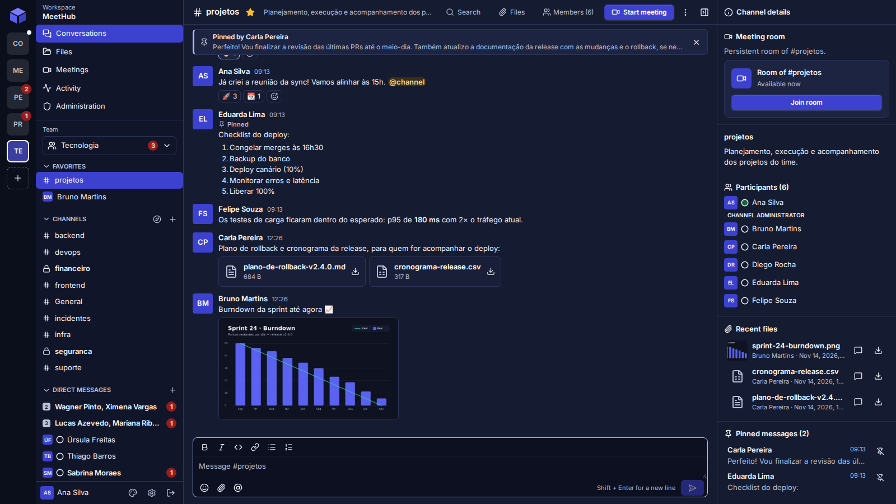
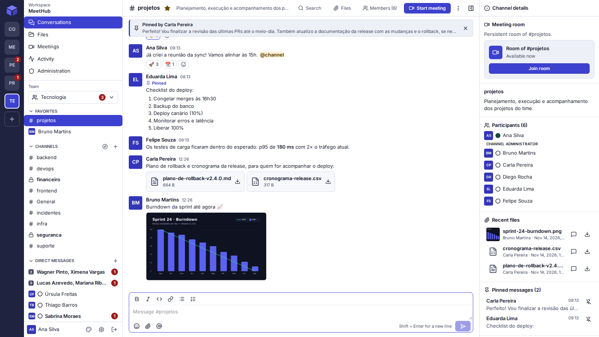
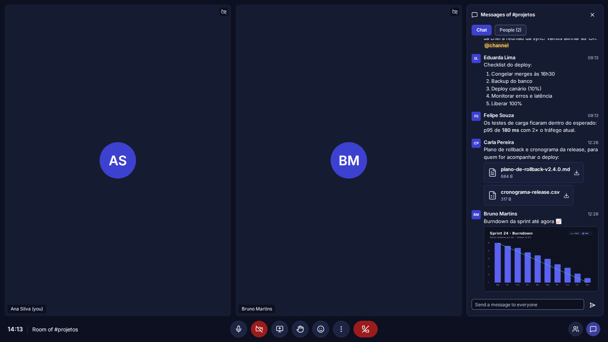
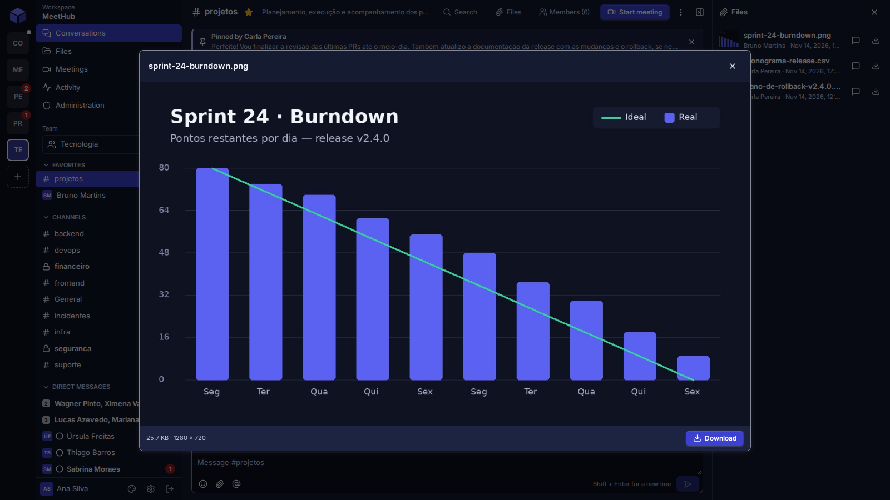

# MeetHub documentation

**MeetHub** is a team chat with files and video meetings that runs on your own server: one static binary
(linux/amd64) with the web app inside, a database (SQLite, MariaDB or PostgreSQL), Redis, and LiveKit for the
meetings. Every setting is an environment variable or a line in `config.toml`.

## Where to start

| I want to… | Read |
|---|---|
| Try it in one container | [Deployment: all-in-one image](deployment.md#all-in-one-image) |
| **Install it on an Ubuntu or Debian server (a package, a systemd service)** | [Install on Ubuntu and Debian](install-linux.md) |
| Install the binary by hand, on any distribution | [Install the binary](install-binary.md) |
| Run it with Compose, on MariaDB or PostgreSQL, or as several replicas | [Deployment](deployment.md) |
| Put it behind nginx with HTTPS | [MeetHub behind nginx](nginx.md) |
| Prepare a real install: HTTPS, a reverse proxy, backups | [Production checklist](deployment.md#production-checklist) |
| Turn on meetings: LiveKit, the ports, TURN | [Meetings](deployment.md#meetings-livekit) |
| Keep the attachments in an S3-compatible bucket | [File storage](deployment.md#file-storage) |
| Send notification e-mails | [Notification e-mails](deployment.md#notification-e-mails-smtp) |
| Understand how it works inside | [Architecture](architecture.md) |
| Know how it is secured | [Security](security.md) |
| Integrate with it | [API](api.md) |
| Make or adjust a theme | [Themes](themes.md) |
| Use the logo | [Brand](brand.md) |
| See what each release brings | [Changelog](../CHANGELOG.md) |

## Run it your way

| | For | What runs |
| --- | --- | --- |
| **All-in-one image** | A single host, a small team, a first look | One container: MeetHub, Redis and LiveKit, SQLite on a volume |
| **Linux package** | A server without Docker | A `.deb` or `.rpm`: everything in `/opt/meethub`, a systemd service, the distribution's Redis |
| **Compose stack** | A team server with meetings | MeetHub, Redis and LiveKit; SQLite, MariaDB or PostgreSQL |
| **Replicas** | Larger installs, no single point of failure | Several MeetHub replicas behind a load balancer, PostgreSQL or MariaDB, Redis, an S3 bucket, LiveKit |



How the pieces work together — message delivery, uploads, joining a meeting, scaling out — is in the
[architecture guide](architecture.md).

To look around with sample data first: from a checkout, this brings up the Compose stack and fills it with a demo
company — 30 people, 4 teams, channels with history, threads and files:

```bash
git clone https://github.com/jniltinho/meethub && cd meethub
make up      # MeetHub + Redis + LiveKit on http://localhost:8080
make demo    # sample users, teams, channels and conversations (prints how to log in)
```

## What you get

**Conversations**

- Teams, public and private channels, direct and group messages, with a team rail to switch between teams.
- Threads, reactions, `@mentions` (`@channel`, `@here`), Markdown, 1 800+ emoji, pinned messages and favorites.
- Message search with `from:` and `in:`, and a jump straight to the message in its channel.
- Activity: mentions and replies to your threads in one place, with desktop notifications and an e-mail for what
  you missed.
- Real-time delivery, unread and mention counts, typing indicators and presence (online, away, do not disturb).
- It keeps working on a bad connection: a message that could not be sent stays with a Retry, and the app catches up
  by itself when the connection returns.

**Files**

- Attach by button, drag and drop or paste; up to 10 files per message, 50 MiB each by default.
- Thumbnails and previews for images, a files panel in every channel and a Files page across all your conversations.
- Stored on a disk volume or in any S3-compatible bucket ([RustFS](https://github.com/rustfs/rustfs), MinIO, AWS S3).

**Meetings** (through [LiveKit](https://livekit.io), self-hosted)

- One persistent room per channel and conversation: no links to create or share.
- Camera and microphone check before joining, screen sharing at the screen's own resolution, raise hand, reactions,
  the people list, the elapsed time and the channel's chat beside the call.
- While you present, a banner lets you share something else without stopping.
- Everyone sees who is in a room, from the channel header, the sidebar and the Meetings page.

**Administration and security**

- Roles (owner, admin, member, guest), user management, an audit log of administrative actions.
- Server-side sessions, CSRF protection, rate limits, strict security headers and a locked-down content policy.
- Files are only served to people who can read their channel, and never render from MeetHub's origin.
- Secrets only through the environment — never in a configuration file, a log or the audit trail.

More in the [security notes](security.md).

**Interface**

- 22 themes, light and dark, six of them at WCAG AAA contrast; each person picks their own ([Themes](themes.md)).
- English, Portuguese (Brazil) and Spanish.
- Keyboard and screen-reader friendly, from a phone to a 4K screen.

| | |
| --- | --- |
|  |  |
|  |  |

All screens use fictional data.

## Where it stands

MeetHub is young and moving fast. What is described here works today and is covered by automated tests on SQLite,
MariaDB and PostgreSQL: unit and integration tests, browser tests of every screen, accessibility and contrast checks,
and a load test (1 000 connections, a 500-member channel, slow clients, a Redis restart). The packages are installed
in clean Debian, Ubuntu and AlmaLinux containers before every release.

Not there yet, so you can plan around it:

- Single sign-on (OIDC, SAML, LDAP) and two-factor authentication — login is e-mail and password.
- Push notifications on phones — notifications are on the desktop and by e-mail.
- Native mobile and desktop apps — MeetHub is a responsive web app.
- Meeting recordings.

Meetings need a LiveKit server reachable by your users; the all-in-one image and the Compose stack set one up for
a single host, and the [deployment guide](deployment.md#meetings-livekit) explains what a public install needs
(TLS, ports, TURN).

Found a problem or missing something for your team? [Open an issue](https://github.com/jniltinho/meethub/issues).

## For developers

Go (Cobra, Echo v5, GORM, Asynq) with an embedded Vue 3 + TypeScript app. Everything builds and tests in Docker; the
host needs only Docker and `make`.

```bash
make build      # dist/meethub: the static linux/amd64 binary
make package    # dist/packages: the .deb, .rpm and .tar.gz of that binary
make check      # gofmt, go vet, golangci-lint, govulncheck, frontend lint and types
make test       # Go tests with -race and the frontend unit tests
make test-db    # the Go tests on SQLite, MariaDB and PostgreSQL (and an S3 service)
make test-e2e   # browser tests on the three databases
make dev        # Vite dev server with hot reload in front of the stack
```

Without `make`, the binary alone:

```bash
docker build --platform linux/amd64 --target export --output dist .
```

Behavior changes go through [OpenSpec](../openspec/) (proposal, specs with testable scenarios, tasks); the
conventions are in [AGENTS.md](../AGENTS.md). The chat follows the Mattermost model and API shapes where it makes
sense.
