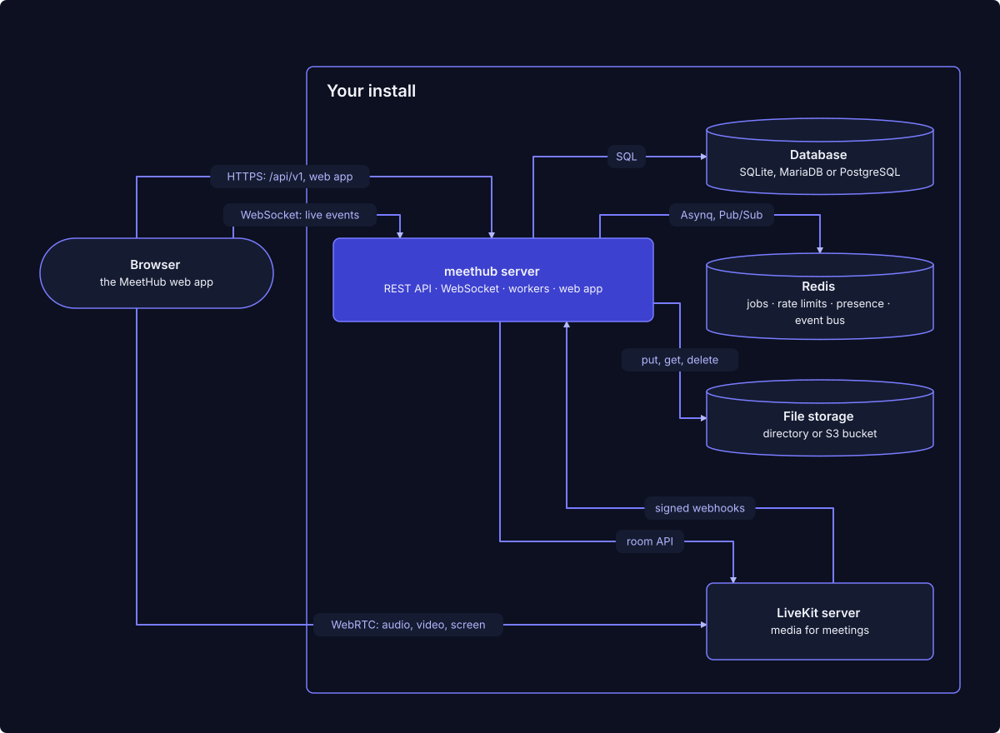
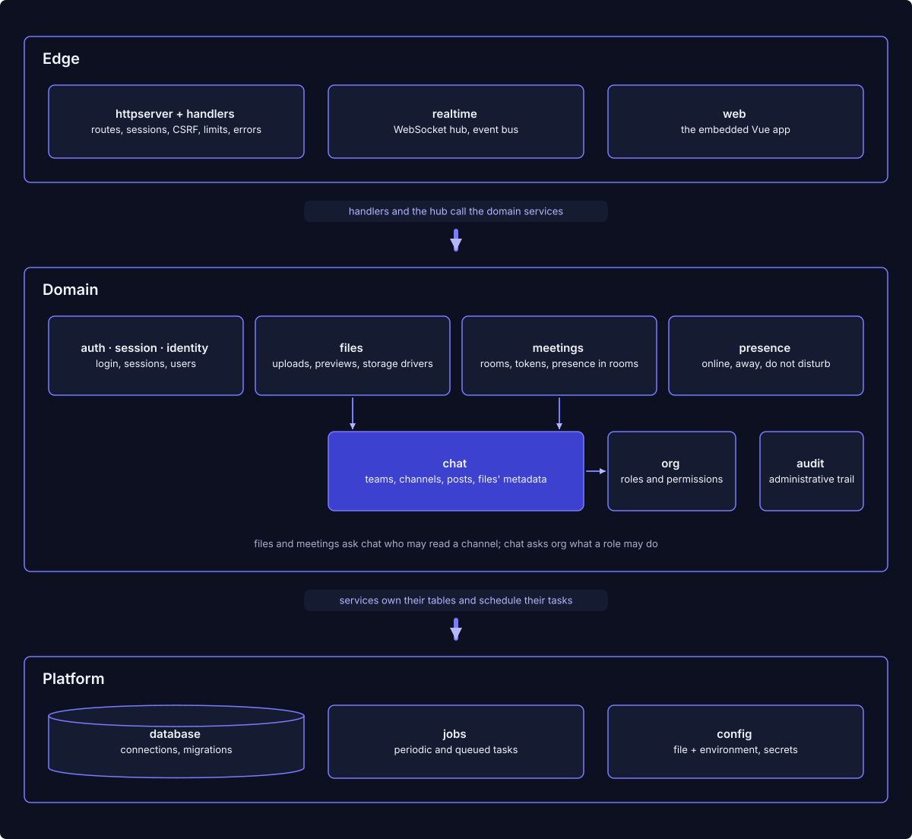
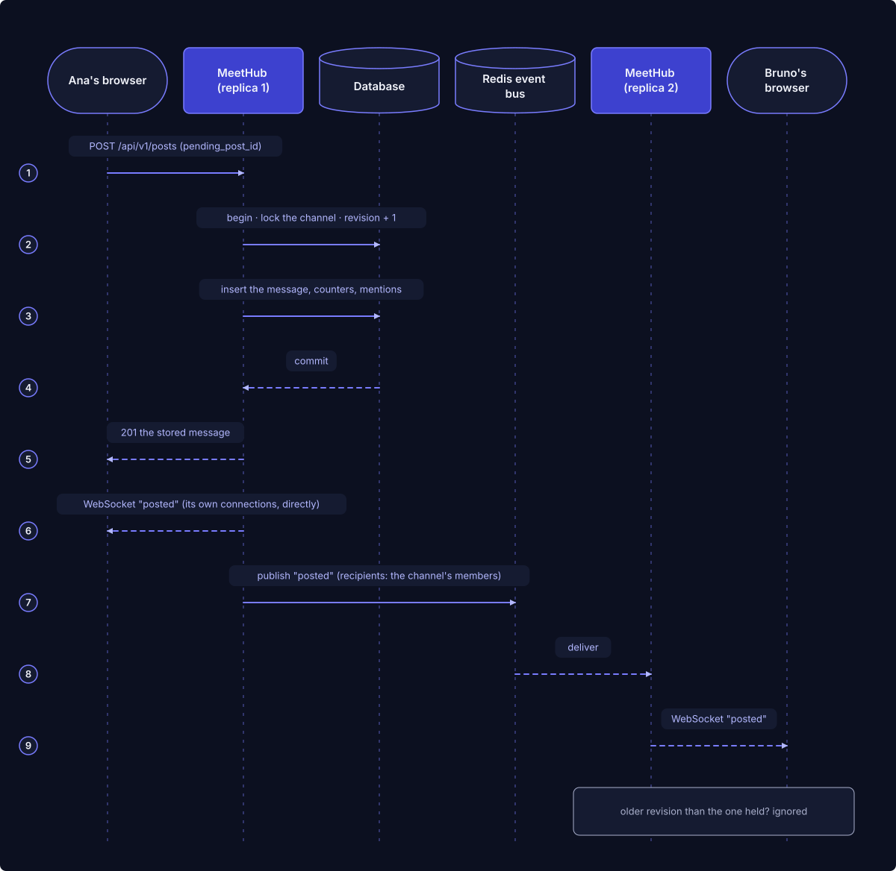
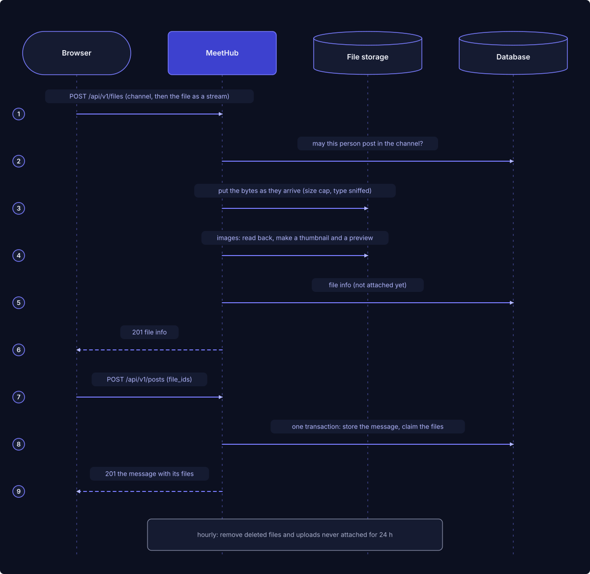
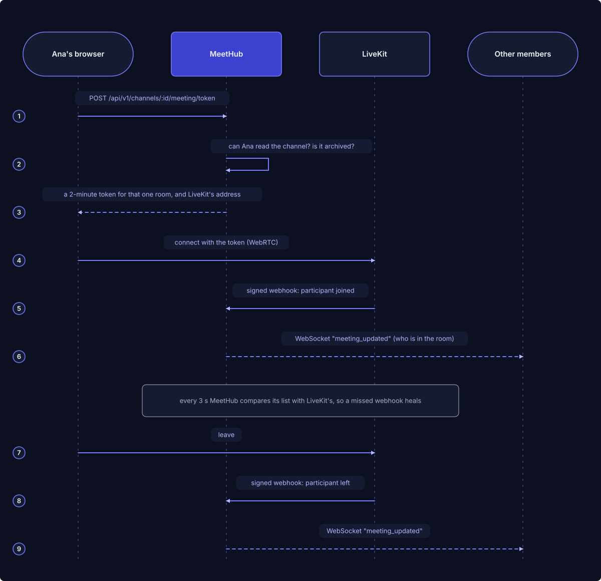
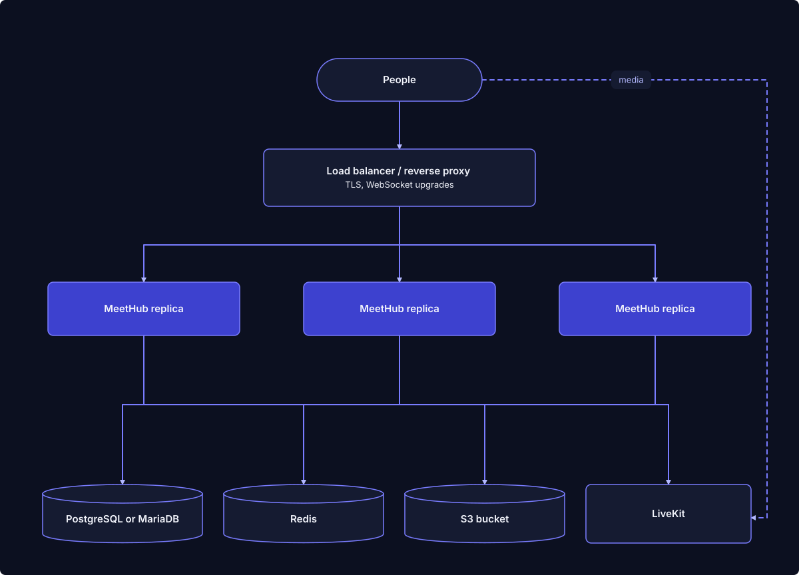

# Architecture

How MeetHub is put together and how a message, a file and a meeting travel through it. For installing and
configuring, see [Deployment](deployment.md); for every endpoint and event, see [API](api.md).

## The pieces

MeetHub is one process: the HTTP API, the WebSocket hub, the background workers and the web app (embedded in the
binary) all run in `meethub server`. It needs a database and Redis; file storage and LiveKit are where attachments
and calls live.

| Piece | What it holds | Notes |
| --- | --- | --- |
| **Database** | Organization, users, sessions, teams, channels, messages, file metadata, meeting rooms, audit log | One dialect per install. Migrations run at startup. SQLite is for a single node. |
| **Redis** | Background jobs (Asynq), shared rate limits, presence, the event bus between replicas | Required. During a short outage each replica keeps serving its own connections. |
| **File storage** | The bytes of attachments | `local` (a directory, shared by every replica) or `s3` (any S3-compatible service). |
| **LiveKit** | Nothing durable: live audio, video and screen sharing | Optional. Without it everything else works and meetings are off. |

## Inside the binary

The server is a set of small Go packages with one direction of dependencies: HTTP handlers call domain services,
domain services own their tables and their rules, and nothing in the domain knows about HTTP.

Authorization lives in the server, in `org` (what a role may do) and `chat` (who may read or post in a channel). The
web app only hides what the server would refuse.

## A message, end to end

Every write to a channel takes that channel's row lock and stamps a growing **revision** on what it changes. The
event leaves only after the transaction commits, so every replica and every browser sees changes in one order, and a
browser can ignore anything older than what it already holds.

- **At most once.** The browser sends each message with a key (`pending_post_id`); a retry with the same key returns
  the stored message instead of creating another.
- **Catching up.** After a dropped connection the browser asks for everything after the last revision it saw
  (`GET /channels/:id/posts?since_revision=…`), so nothing is lost and nothing is duplicated.
- **Slow consumers.** A connection that cannot keep up is closed and resynchronizes; it never slows the others down.

## A file, end to end

Files are uploaded before the message is sent, straight to the storage, and become part of a message only inside the
transaction that stores it.

- A file is served only to people who can read its channel at that moment, always as a download, in a sandbox —
  an uploaded HTML or SVG file never runs from MeetHub's address.
- Storage keys are generated by the server; a file's name is only metadata.
- Thumbnails and previews are the server's own re-encodings, without the original's metadata (location, device).

## A meeting, end to end

Each channel and conversation has one persistent room. MeetHub decides who may enter and tells everyone who is
inside; LiveKit carries the media directly between the browsers and itself.

- Room names are random; nothing about a channel can be derived from its room, and a token opens only its own room.
- Someone removed from a channel is disconnected from its room.
- The chat beside a call is the channel's own chat: messages sent there are ordinary messages.

## Running more than one replica

Replicas share the database, Redis and the file storage; nothing is kept in a replica's memory that another one
would need, so the load balancer needs no sticky sessions.

- An event published by one replica reaches the browsers connected to all of them through Redis.
- Periodic tasks (session cleanup, file cleanup) run once per period across all replicas.
- Open WebSockets are checked against the database every 5 seconds: a connection closes within 5 seconds of its
  session ending, even while Redis is down.
- On shutdown a replica stops accepting connections and closes its sockets; browsers reconnect to another replica
  and catch up through the API.

The scale budget and proxy settings are in [Deployment](deployment.md#real-time-chat-behind-a-proxy).

## The web app

A Vue 3 + TypeScript single-page app, built with the server and embedded in the binary — there is no separate
frontend to deploy.

- One store keeps teams, channels and messages normalized by id and applies the revision rule, so duplicated, late
  or out-of-order events converge to the same state.
- Themes are a contract of role tokens (surface, text, action, …): 22 themes fulfil it, each checked for contrast
  in the browser tests ([Themes](themes.md)).
- Every text goes through the catalogs (English, Portuguese (Brazil), Spanish); a test fails on a missing or stale
  translation.
